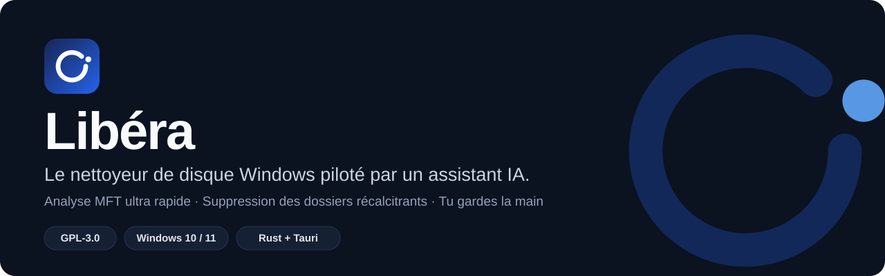
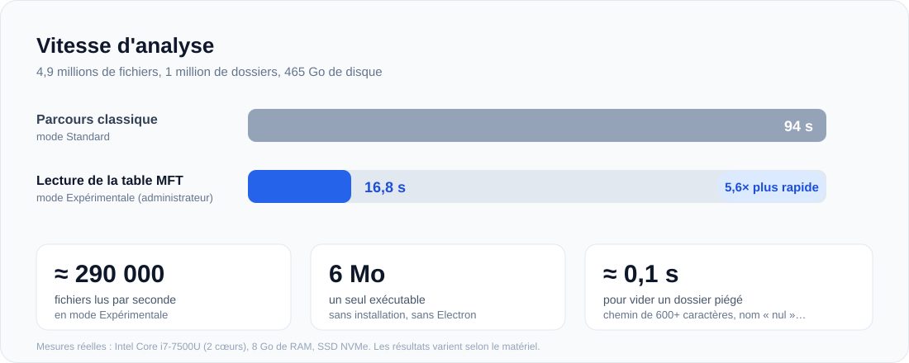

<p align="center">
  
</p>

<p align="center">
  <a href="LICENSE"></a>
  
  
  
  
</p>

# Libéra : nettoyeur de disque Windows avec assistant IA

**Libéra** est un **nettoyeur et analyseur d'espace disque pour Windows**, libre et open source. Il est construit autour de deux idées : un **moteur d'analyse nouvelle génération** (lecture directe de la table MFT de NTFS) et un **assistant IA** qui trie, archive, désinstalle et range, mais **demande toujours avant d'agir**.

Il sert à **libérer de l'espace disque**, à **trouver ce qui pèse lourd**, à **supprimer les dossiers que Windows refuse de supprimer** et à **ranger le Bureau**, sans jamais toucher à ce que tu as choisi de protéger. Alternative libre aux outils de nettoyage de disque classiques : un seul exécutable de 6 Mo, sans installation.

> **En bref :** analyse de 4,9 millions de fichiers en **17 secondes**, suppression des cas « impossibles » (noms réservés, chemins de plus de 260 caractères, fichiers verrouillés), assistant qui te pose la question dans le chat avec un bouton **Autoriser / Refuser**.

<p align="center"><a href="#installer">Installer</a> · <a href="#vitesse-danalyse">Vitesse</a> · <a href="#lassistant">Assistant</a> · <a href="#securite">Sécurité</a> · <a href="#fonctions">Fonctions</a> · <a href="#questions-frequentes">FAQ</a> · <a href="#english-summary">English</a></p>

---

## Pourquoi Libéra

- **Rapide.** Le mode Expérimentale lit la table MFT au lieu de lister les dossiers un par un : environ 6 fois plus rapide que le parcours classique.
- **Il supprime ce que Windows n'y arrive pas.** Dossiers avec un point ou un espace final, noms réservés (`nul`, `con`…), chemins trop longs, fichiers en lecture seule ou système, fichiers verrouillés (le programme coupable est nommé), entrées corrompues.
- **Tu décides de ce qui est protégé.** Projets de code, musique, création graphique, dossiers précis : rien n'est imposé, tout se règle. Seuls les dossiers vitaux de Windows restent toujours protégés.
- **Un assistant qui demande.** Il agit avec des outils sécurisés, te pose la question quand une protection bloque, et ne peut jamais supprimer lui-même.
- **Léger et transparent.** Rust et Tauri, pas d'Electron, aucune télémétrie, aucun serveur. Le code est ouvert.

## Vitesse d'analyse

<p align="center"></p>

| Mode | Principe | Durée mesurée* |
|---|---|---|
| Rapide | caches, temporaires, corbeille, applications | ≈ 15 s |
| Standard | parcours complet parallèle (dossiers, gros fichiers) | ≈ 94 s pour le parcours |
| Approfondie | tous les fichiers dès 1 Mo, doublons vérifiés par contenu (BLAKE3) | quelques minutes |
| **Expérimentale** | **lecture directe de la table MFT NTFS** (administrateur) | **≈ 17 s** |

\* Mesures réelles : 4,9 millions de fichiers, 1 million de dossiers, SSD NVMe de 465 Go, Intel Core i7-7500U (2 cœurs), 8 Go de RAM. Les résultats dépendent du matériel. Le mode Expérimentale voit aussi ce que le parcours classique ne voit pas : dossiers protégés, table `$MFT`, fichiers OneDrive « en ligne seulement ».

## L'assistant

<p align="center"></p>

Libéra pilote **Claude Code avec ton propre abonnement** (aucune clé d'API, aucun serveur intermédiaire). Tu choisis le modèle (Haiku économe, Sonnet équilibré, Opus puissant) et un compteur affiche les tokens consommés.

Exemples de demandes, en français :

- « Libère 100 Go, dis-moi d'abord ce que tu peux toucher sans risque. »
- « Désinstalle les applications que je n'utilise plus. »
- « Retire tous les plugins et VST que j'ai installés, proprement. »
- « Supprime les images et vidéos qui ne sont reliées à aucun projet. »
- « Archive mes projets de musique dans un zip, puis propose de supprimer les originaux. »
- « Range mon Bureau par domaines, sans rien casser. »
- « Le dossier `Claude-Data`, c'est important ? »

Ce que l'assistant sait faire : analyser le disque, expliquer un dossier (et dire « je ne sais pas »), chercher les fichiers inutilisés, les médias hors projets et les plugins audio, retrouver tes projets, **archiver en `.zip` vérifié**, désinstaller des applications en file, **ranger le Bureau** (raccourcis réparés, rangement annulable) et remplir le panier avec une raison par ligne. Ses réponses s'affichent proprement : tableaux, titres, boutons de réponse rapide, chemins cliquables.

## Sécurité

<p align="center"></p>

- **Aucune suppression sans ta confirmation finale**, avec un rapport clair de ce qui a résisté et pourquoi.
- Les liens et jonctions sont retirés seuls : leur cible n'est jamais suivie.
- Les archives sont **vérifiées** (relecture complète et contrôle des sommes) avant que les originaux puissent être proposés à la suppression.
- Le serveur local de l'assistant n'écoute que sur `127.0.0.1`, avec un jeton aléatoire par lancement, et n'expose **aucun outil de suppression directe**.
- Libéra n'envoie rien nulle part. L'assistant passe uniquement par ton installation de Claude Code.

## Fonctions

| | |
|---|---|
| **Analyse** | Quatre modes, dossiers les plus lourds, gros fichiers, doublons vérifiés par contenu. |
| **Nettoyage** | Caches (navigateurs, outils de développement), fichiers temporaires, journaux, corbeille, dossiers reconstructibles (`node_modules`, `target`, `.next`…). |
| **Fichiers inutilisés** | Score de confiance expliqué ligne par ligne : installateurs déjà installés, archives déjà extraites, captures, copies. |
| **Applications** | Dernière ouverture lue dans Windows, désinstallation suivie jusqu'au bout, **suppression forcée** quand le désinstalleur échoue (service et dossier retirés, registre nettoyé). |
| **Suppression robuste** | Chemins étendus, droits corrigés, suppression « POSIX » des fichiers ouverts, méthodes de secours, suppression au redémarrage. |
| **Archivage** | Regroupe des projets dans un `.zip` vérifié avant toute suppression. |
| **Bureau** | Rangement par domaines, raccourcis réparés, journal d'annulation. |
| **Protections** | Code, musique, création graphique, dossiers précis, autorisations accordées dans le chat : tout est réglable. |

## Installer

1. Récupère `libera.exe` dans les **[Releases](../../releases)** (ou compile, voir plus bas).
2. Lance-le. Clic droit puis *Exécuter en tant qu'administrateur* pour le mode Expérimentale, la suppression de services et certaines zones système.

**Prérequis :** Windows 10 ou 11 (NTFS), WebView2 (déjà présent sur Windows 11 et la plupart des Windows 10). Pour l'assistant : [Claude Code](https://claude.com/claude-code) installé et connecté (`claude`, puis `/login`).

### Compiler

```bash
# Rust stable (MSVC) et les Build Tools Visual Studio sont nécessaires
cargo build --release
# application : target/release/libera.exe
# outil de diagnostic : target/release/libera-cli.exe
```

```
core/            moteur Rust : analyse, MFT, suppression robuste, archivage, protections, rangement du Bureau
app/src-tauri/   application Tauri 2 et serveur MCP local de l'assistant
app/ui/          interface (HTML, CSS, JavaScript, sans dépendance)
assets/          logo et illustrations
```

L'outil en ligne de commande sert au diagnostic : `libera-cli scan C:\ standard`, `libera-cli stale 12`, `libera-cli preview <chemin>`, `libera-cli delete <chemin> --oui`.

## Questions fréquentes

**Comment libérer de l'espace disque sous Windows rapidement ?**
Lance une analyse Standard ou Expérimentale : Libéra classe ce qui pèse lourd, propose les caches et dossiers reconstructibles sans risque, puis te laisse décider du reste. L'assistant peut le faire pour toi en te demandant avant chaque choix sensible.

**Comment supprimer un dossier « impossible à supprimer » sous Windows ?**
Les causes habituelles sont un nom invalide (point ou espace final, `nul`, `con`), un chemin de plus de 260 caractères, des droits cassés ou un fichier verrouillé. Libéra utilise des chemins étendus, corrige les droits, contourne les fichiers ouverts, nomme le programme qui verrouille et propose la suppression au redémarrage.

**Comment désinstaller un programme qui refuse de se désinstaller ?**
Dans l'onglet Applications, le bouton **Forcer** arrête les processus et services du programme, supprime son dossier et retire son entrée de la liste des applications Windows, après une confirmation détaillée.

**Libéra est-il une alternative à CCleaner, WinDirStat ou WizTree ?**
C'est un outil libre qui réunit l'analyse d'espace disque, le nettoyage et la suppression robuste, avec en plus un assistant IA et un mode de lecture MFT. Chacun a ses forces : essaie-le sur un dossier de test.

**Mes données sont-elles envoyées quelque part ?**
Non. Libéra n'a aucune télémétrie. Si tu utilises l'assistant, les échanges passent par ton propre Claude Code, selon ses règles.

**L'assistant peut-il supprimer mes fichiers sans me demander ?**
Non. Il remplit un panier ; la confirmation finale est toujours la tienne.

## Feuille de route

- [ ] Version signée et publiée dans les Releases
- [ ] Captures d'écran et démonstration vidéo
- [ ] Traductions (anglais en priorité)
- [ ] Planification de nettoyages réguliers

## Contribuer

Les contributions sont les bienvenues : ouvre une *issue* pour discuter, puis une *pull request*. Merci de ne jamais affaiblir les garde-fous de suppression sans en discuter, et de tester uniquement sur des dossiers de test.

## Crédits

**Libéra** est créé par **NGUEME OYONE FRANCK MEHDI**, fondateur de **Vortex**.

Construit avec [Rust](https://www.rust-lang.org/), [Tauri](https://tauri.app/), [rayon](https://github.com/rayon-rs/rayon), [BLAKE3](https://github.com/BLAKE3-team/BLAKE3), [zip](https://github.com/zip-rs/zip2) et [windows-sys](https://github.com/microsoft/windows-rs).

## Licence

[GNU General Public License v3.0](LICENSE) © 2026 NGUEME OYONE FRANCK MEHDI, fondateur de Vortex. Tu peux utiliser, étudier, modifier et partager Libéra ; les versions modifiées que tu distribues doivent rester sous la même licence, avec le code source.

---

## English summary

**Libéra** is a free, open-source **Windows disk cleaner and disk-space analyzer** built around an **AI assistant** and a **next-generation scan engine** that reads the NTFS **Master File Table (MFT)** directly: about **4.9 million files scanned in 17 seconds** (vs 94 s with a classic directory walk) on a 2-core laptop with an NVMe SSD.

- **Deletes what Windows can't**: reserved names (`nul`, `con`), trailing dots or spaces, paths over 260 characters, read-only and locked files (the locking program is named), corrupted entries.
- **You choose what is protected** (code projects, music, design work, specific folders). Only vital Windows folders are always protected.
- **An assistant that asks permission**: it analyses, archives (verified `.zip`), uninstalls, organizes the desktop and fills a basket, asks with an *Allow / Deny* button when a protection blocks it, and **can never delete by itself**. It runs on your own Claude Code subscription.
- Single ~6 MB executable (Rust + Tauri), no telemetry, GPL-3.0. Windows 10/11, NTFS.

Build: `cargo build --release`. Keywords: disk cleaner, disk space analyzer, free up disk space, MFT scanner, force delete locked folder, Windows cleanup tool, AI assistant, open source.
